 

&nbsp;

## 👋 About Me

  
  

## 🛠 Tech Stack

  
  

## 🚀 Featured Projects

  
   
  <a href="https://github.com/Adbhut1234/SIH-2026">SIH-2026</a> &nbsp;·&nbsp;
  <a href="https://github.com/Adbhut1234/Codeverse">Codeverse</a> &nbsp;·&nbsp;
  <a href="https://github.com/Adbhut1234/Hackathon-Hack2skill">Hackathon-Hack2skill</a> &nbsp;·&nbsp;
  <a href="https://github.com/Adbhut1234/Zenith">Zenith</a> &nbsp;·&nbsp;
  <a href="https://github.com/Adbhut1234/Smart-Attendance-System">Smart-Attendance-System</a>
  

## 📊 GitHub Analytics

  
   
  

  

