  

## About

I am a B.Tech Computer Science & Engineering undergraduate at Shri Ramswaroop Memorial University specializing in **AI Agents, Real-Time Multimodal Systems, and Full-Stack Engineering**. I build autonomous agents, developer tooling, and modern web applications with Python, TypeScript, and Next.js, and actively compete in national hackathons.

- **Education:** B.Tech, Computer Science & Engineering, Shri Ramswaroop Memorial University
- **Focus Areas:** Autonomous Agent Architectures, Real-Time Audio/Vision (LiveKit, Gemini Live API), Cloud IDEs
- **Core Languages:** Python, TypeScript, JavaScript, SQL

## Projects

  

- **[Zenith](https://github.com/Adbhut1234/Zenith)** — Vision-grade cognitive desktop assistant featuring LiveKit WebRTC, Gemini Multimodal Live API, AST code phasing, and a sovereign SQLite vector memory matrix.
- **[CodeVerse](https://github.com/Adbhut1234/Codeverse)** ([Live Demo ↗](https://codeverse-main-ruby.vercel.app)) — Cloud-based IDE featuring Monaco Editor, Next.js App Router, Prisma ORM, and persistent PostgreSQL workspaces on Neon.
- **[SIH-2026](https://github.com/Adbhut1234/SIH-2026)** — National innovation challenge prototype developed for Smart India Hackathon 2026.
- **[Smart-Attendance-System](https://github.com/Adbhut1234/Smart-Attendance-System)** — Automated computer-vision facial recognition attendance tracking pipeline.
- **[Hackathon-Hack2skill](https://github.com/Adbhut1234/Hackathon-Hack2skill)** — Rapid full-stack prototype engineered under competitive hackathon constraints.

## Activity

  
  

## Contact

- **Email:** [adbhutpandey93@gmail.com](mailto:adbhutpandey93@gmail.com)
- **GitHub:** [@Adbhut1234](https://github.com/Adbhut1234)
- **CodeVerse Live:** [codeverse-main-ruby.vercel.app](https://codeverse-main-ruby.vercel.app)
